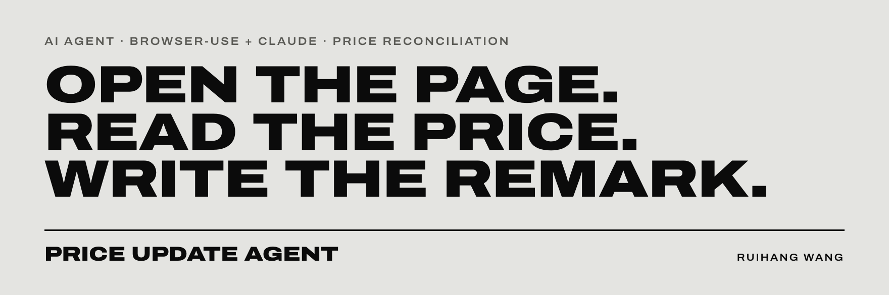
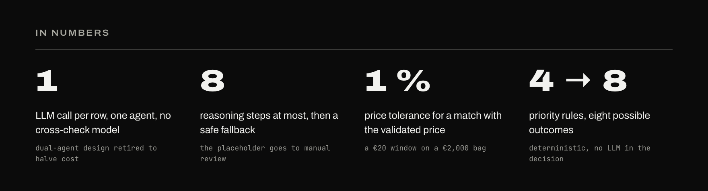

**[SETUP](docs/01_setup.md)** &nbsp;·&nbsp;
**[OPERATIONS](docs/02_operations.md)** &nbsp;·&nbsp;
**[SPECIFICATION](docs/03_specification.md)** &nbsp;·&nbsp;
**[PREVIOUS PROJECT](https://github.com/calvinWANG-3333/balenciaga-pricing-pipeline)**

A browser agent that re-checks luxury product prices on brand websites and writes the result back into the
price-check Excel. Built with **browser-use**, **Playwright** and **Claude Sonnet 4.5**. The model only reads the
page; a deterministic rule engine decides what gets written.

<br>

## THE PROBLEM

Every price-check delivery leaves rows nobody can close from the data alone: products **missing in crawl**, and
products flagged **refresh data** because their last price is outside the delivery range. Someone has to open each
URL, find the product, read the price, compare it with the validated one and type a remark. Hundreds of rows, by
hand, every cycle.

## THE AGENT

| PRINCIPLE | IN PRACTICE |
|---|---|
| **ONE ROW, ONE AGENT, ONE CALL** | a single Claude agent opens the URL in Chromium, reads the DOM and returns a typed result |
| **NEVER GUESS A PRICE** | no visible price means `null`; the reference price is context, never the answer |
| **THE MODEL READS, THE RULES DECIDE** | `reconcile.py` turns the result into remarks with a fixed priority cascade, no LLM involved |
| **WHEN IN DOUBT, A HUMAN** | anything below `high` confidence keeps its original remark and is tagged `manual` |
| **THE INPUT IS NEVER TOUCHED** | output goes to a copy, only two columns change, progress is saved every 10 rows |



## FLOW

```
To_be_update.xlsx
   │
   ▼
run_demo.py        eligibility filter · 3 rows in parallel · checkpoint every 10 rows
   │
   ▼
agent_1.py         Claude Sonnet 4.5 · browser-use + Chromium · DOM mode · max 8 steps
   │               → {product_available, url_redirected, price_found, currency_found, evidence, confidence}
   ▼
reconcile.py       P1 redirect + no price   → product gone
   │               P2 page blocked          → manual
   │               P3 high confidence       → write price or "Same price"
   │               P4 anything else         → manual
   ▼
excel_writer.py    copy the input · patch Remarks L1 / L2 · colour by decision
   │
   ▼
To_be_update_filled.xlsx
```

## DECISIONS

| TRIGGER | REFRESH DATA | MISSING IN CRAWL | CELL |
|---|---|---|---|
| **REDIRECT, NO PRICE** | `Missing-remove` | `OK, missing` | red `#F4CCCC` |
| **HIGH, SAME PRICE** | `Refresh data` · `Same price` | `Not OK, available` · `Same price` | green `#C6EFCE` |
| **HIGH, NEW PRICE** | `Refresh data` · new price | `Not OK, available` · new price | green `#C6EFCE` |
| **BLOCKED OR NOT SURE** | original L1 · `manual` | original L1 · `manual` | yellow `#FFEB9C` |

<sub>A PRICE MATCHES WHEN IT IS WITHIN 1 % OF `Original Price_validated`. FULL MATRIX AND CONFIDENCE RUBRIC IN THE [SPECIFICATION](docs/03_specification.md).</sub>

## GUARDRAILS

| WHERE | RULE |
|---|---|
| **INPUT** | only `Missing in crawl` and `Refresh data` rows with a URL and a validated price are processed |
| **BRANDS** | Loewe, Audemars Piguet and Hermès store data stay with a human; the runner warns if any slip through |
| **PAGE** | access denied, 403, 429, Cloudflare, CAPTCHA or bot walls stop the agent at once with `BLOCKED:` |
| **REDIRECT** | only a homepage, category or search page counts; an SEO slug rewrite does not |
| **CONFIDENCE** | `high` needs all four: one price, matching name, fully rendered page, no sale or instalment ambiguity |
| **FAILURE** | no result after 8 steps becomes a `low` placeholder, routed to manual review |

## STACK

| LAYER | TOOLS |
|---|---|
| **AGENT** | browser-use · Claude Sonnet 4.5 via the Anthropic API · Pydantic structured output |
| **BROWSER** | Playwright · Chromium, native ARM64 on Apple Silicon |
| **DATA** | pandas · openpyxl |
| **ENVIRONMENT** | Python 3.11 · `uv` |

## REPOSITORY

```
run_demo.py        orchestrator: eligibility, concurrency, checkpoints, summary
agent_1.py         the browser agent, its prompt and output schema
reconcile.py       rule engine: agent result → Remarks L1 / L2 + decision label
excel_writer.py    writes the decisions to a copy of the input, colour-coded
requirements.txt   dependencies
docs/              setup, operations, specification
```

## RUN IT

```bash
uv venv --python cpython-3.11-macos-aarch64 .venv     # native ARM64 on Apple Silicon, see docs/01_setup.md
source .venv/bin/activate
uv pip install -r requirements.txt
uv run playwright install chromium

export ANTHROPIC_API_KEY="sk-ant-..."                 # the runner refuses to start without it
python run_demo.py                                    # reads To_be_update.xlsx, writes To_be_update_filled.xlsx
```

Prepare `To_be_update.xlsx` first: the pre-filter is manual and described in [OPERATIONS](docs/02_operations.md).
Windows setup, key storage and troubleshooting are in [SETUP](docs/01_setup.md).

<br>

---

<sub>INDEPENDENT PROJECT BY RUIHANG WANG · NOT AFFILIATED WITH ANY BRAND NAMED IN THIS REPOSITORY</sub>
